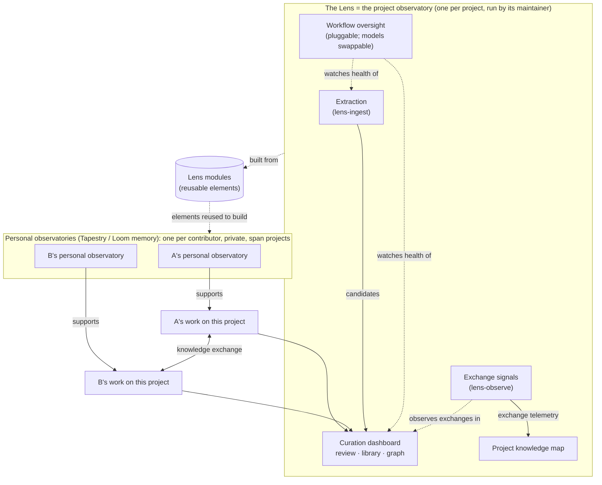
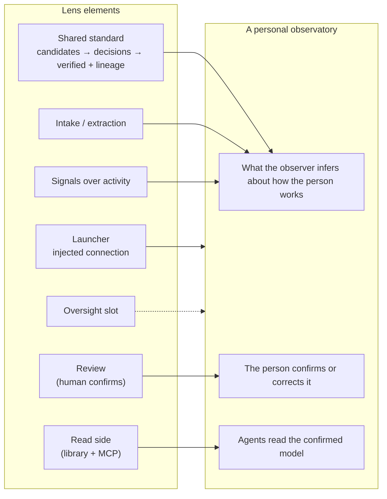

# Observatories: the project observatory and the personal ones

**Status:** approved by the operator (2026-10-21). It is the basis of the roadmap everyone
works from. **For:** the Lens repos, Tapestry, Loom memory,
and anyone building an observatory from these parts.

## In one paragraph

There are two kinds of observatory. **The Lens, with all its modules, is the project
observatory.** There is one per project, run by the project's maintainer, and it is the larger,
shared view. It observes the knowledge exchanges between the project's contributors and agents
and builds a project knowledge map. **Personal observatories** are smaller. There is one per
contributor, it is private, and it follows that person across all their projects. Tapestry
and Loom memory plan to build them from elements of the Lens. The two meet only at a
project's shared interfaces.

## The two observatories

| | Project observatory (the Lens) | Personal observatory |
|---|---|---|
| How many | one per project | one per contributor |
| Run by | the project's maintainer | the contributor (built by Tapestry / Loom memory) |
| Observes | knowledge exchanges between contributors and agents at the project's shared interfaces | one person's work across all their projects |
| Produces | the project knowledge map and the verified project library | the contributor's evolving model of how they work |
| Privacy | shared within the project | private |
| Exists in PROVES? | yes (PROVES is one project's observatory) | no; it comes from the operator's architecture |

## Inside the project observatory

Each Lens module observes something different, for a different reader:

| Part | What it does or observes | For whom | Repo |
|---|---|---|---|
| Shared standard + launcher | the database shape every module meets on; stands up an observatory against an injected `LENS_DB_URL` | every module | lens-core |
| Extraction | agents capture candidates from the project's sources and feed the curation dashboard | contributors | lens-ingest |
| Review + promotion | humans accept, reject or edit candidates; accepted ones enter the library | contributors | lens-review |
| Library, graph, MCP read | people and agents use what has been verified | contributors, agents | lens-serve |
| Exchange signals | how knowledge moves between contributors: reviewer patterns, calibration, activity | the project | lens-observe |
| Workflow oversight | whether the machinery works: pipeline and intake health, errors, agent trust and proposals | the maintainer | new repo (proposed, name pending) |
| Access + tenancy | organizations, members, roles, sign-in, row security | every module | new repo (proposed, name pending) |

Workflow oversight is a **slot**, not a fixed team. It writes health, trust and proposal records
that the dashboard reads, and the standard names no model, so the agents that fill it can change
at any time.

## Lens elements a personal observatory could reuse

These are candidates for Tapestry and Loom memory to judge, not a design for them. Tapestry
decides what its personal observatory needs.

| Lens element | Possible use at personal scale |
|---|---|
| Shared standard (candidates → decisions → verified, with lineage) | inferences about the person stay candidates until the person confirms them, with a record of where each came from |
| Launcher with injected connection | a personal observatory is another instance, pointed at the person's own private database |
| Intake / extraction | capture from the person's own sources |
| Review | the person confirms, corrects or rejects what was inferred |
| Read side (library + MCP) | the person's agents read only the confirmed model |
| Signals over activity | activity signals across the person's projects |
| Oversight slot | watches the health of the personal observer's own agents |

**What this asks of every Lens module:**
- **Neutral about scale:** nothing assumes "one project" when it could be "one person".
- **Injected connection:** nothing hardcodes a backend.
- **Small interface:** each module's interface is only what it touches on the shared bus.

The Lens already follows these as reuse rules. Personal reuse is a further reason to keep them.

## The boundary between them

- A project observatory receives only what happens at the project's shared interfaces:
  contributions, reviews, explanations, handoffs.
- A personal observatory keeps everything else private. Taking part in a project does not
  expose a contributor's other projects or private context.
- Anything more that crosses from personal to project crosses because the contributor chose to
  send it.
- In the database, this is a rule on what crosses the bus (like row security), not a table.
  Where it is enforced is still open.

## Open

- Names for the two proposed repos (workflow oversight; access + tenancy).
- Which Lens elements Tapestry actually reuses, and whether they are shared as packages or
  copied. Tapestry is breaking itself down now, so this follows its plan.
- Where the personal-to-project boundary is enforced (in the standard, in each personal
  observatory, or both).

## Sources

- Surveyor module map, section 7: `Lizo-RoadTown/surveyor`,
  `docs/decomposition/proves/module-map.md`.
- Surveyor evaluation: `docs/decomposition/evaluations/2026-10-21-observation-layers.md`.
- The operator's description of individual and shared project layers, 2026-10-21.
